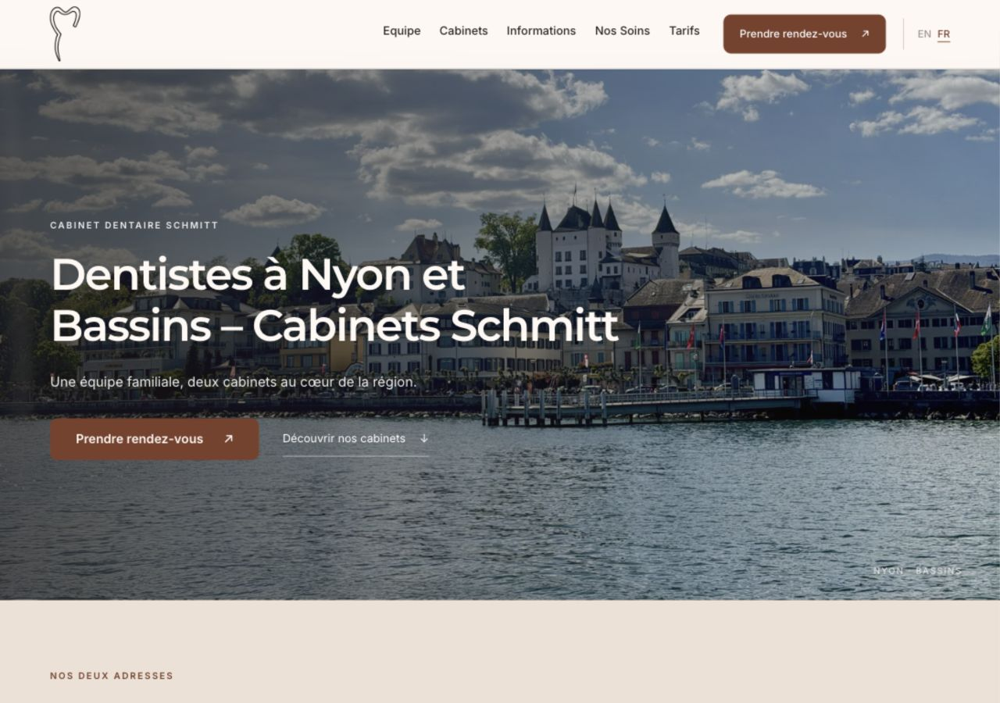
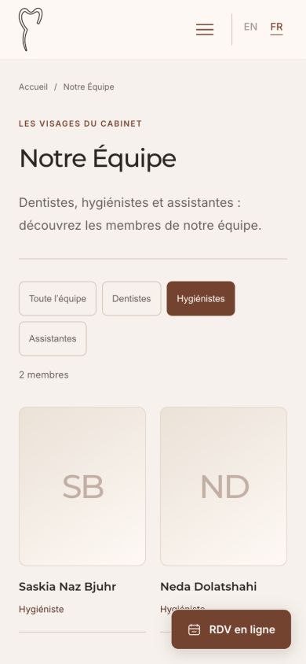

# Publication du design premium — 29 octobre 2026

Version **1.2.0** installée sur https://dentisteschmittnyon.ch/ après accord du propriétaire. Accueil et pages intérieures FR/EN reprennent le design approuvé sur le staging `1.2.0-rc4`.

## Sauvegarde et installation

- Sauvegarde manuelle complète fichiers et base créée chez Hostinger avant le remplacement. Fin confirmée dans le panneau : **2026-10-29 18:21** (horodatage affiché par Hostinger).
- Archive `dist/dentisteschmitt-1.2.0.zip` : 33 fichiers, 3 871 287 octets ; SHA-256 `a91ef0712aa45b57000fe9e9bf95488e52e7e497316c1b72dcb34ec3b9757e74`.
- Comparaison avec l’archive approuvée rc4 : même liste de fichiers ; seuls les marqueurs de version dans `functions.php` et `style.css` passent à `1.2.0`.
- Thème existant `wp-content/themes/dentisteschmitt/` remplacé via WordPress : **1.1.1 → 1.2.0**, confirmation « Le thème a bien été mis à jour ».
- Aucun transfert de la base du staging. Contenus, réglages, médias, traductions protégées de Loco et extensions de production conservés.
- WordPress confirme la purge des caches lors de la mise à jour. Cache Hostinger/CDN vidé, confirmation de succès dans hPanel.

## Validation après publication

- `python3 tests/seo-smoke.py --base-url https://dentisteschmittnyon.ch --english --local-pages` : **18 pages publiques validées** ; métadonnées, canoniques, hreflang, un H1, identifiants et ancres, liens et schémas locaux ; redirections historiques 301 et traitement 404/recherche noindex conformes.
- Rapport : [validation-public-1.2.0.txt](evidence/validation-public-1.2.0.txt).
- 16 ressources internes distinctes relevées sur six pages : HTTP 200. Styles premium et intérieurs et version 1.2.0 servis ; aucune référence au domaine de staging dans les pages échantillonnées.
- Balise Google Site Kit toujours présente sur l’accueil public ; indexation publique autorisée.
- Staging inchangé : version rc4, noindex et absence de balise Google Analytics.
- Rapport complémentaire : [validation-public-assets-1.2.0.txt](evidence/validation-public-assets-1.2.0.txt).
- Rendu de l’accueil contrôlé à 1280 px ; équipe contrôlée à 390 px sans débordement horizontal. Filtre Hygiénistes : 2 membres. Menu mobile ouvert puis fermé avec Échap (`aria-expanded=false`). FAQ dépliée et réponse visible. Galerie Nyon passée de 01/03 à 02/03.
- Aucun rendez-vous soumis pendant les essais. La validation détaillée du staging reste décrite dans les comptes rendus précédents ; ces contrôles de publication ne constituent pas un audit exhaustif de tous les appareils.

## Captures publiques

## Retour arrière

En cas de régression : restaurer le thème 1.1.1 ou utiliser la sauvegarde Hostinger ci-dessus. Ne restaurer la base que si nécessaire, afin de préserver d’éventuels changements de contenu effectués depuis la publication.
